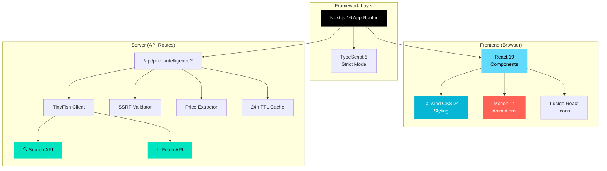
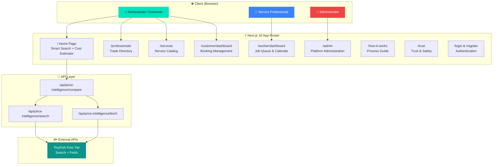
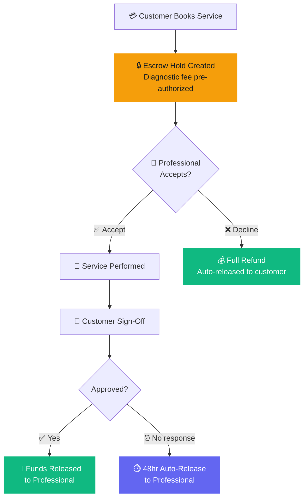
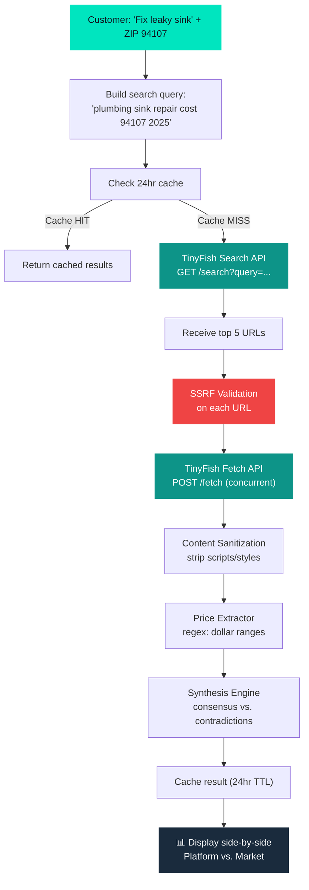
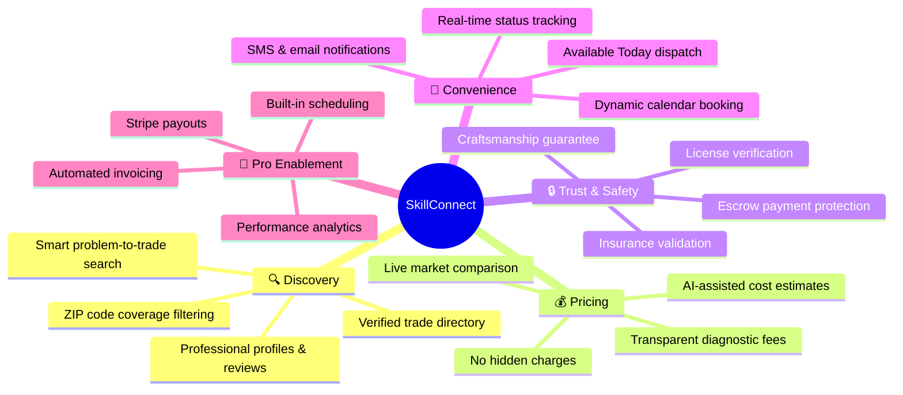

# SkillConnect — Connecting People with Trusted Local Service Professionals

> **Tagline:** Find trusted help. Book confidently. Get the job done.

[](#7-documentation-system--quick-links)
[](#1-implementation-status)
[](#2-developer-quickstart--operational-commands)
[](#2-developer-quickstart--operational-commands)
[](https://nextjs.org)
[](https://react.dev)
[](https://tailwindcss.com)
[](TINYFISH.md)

---

## 📋 Table of Contents

1. [Implementation Status](#1-implementation-status)
2. [Developer Quickstart](#2-developer-quickstart--operational-commands)
3. [Technology Stack](#3-technology-stack)
4. [Application Architecture & Workflow](#4-application-architecture--workflow)
5. [Product Overview](#5-product-overview)
6. [Live Local Price Intelligence (TinyFish)](#6-live-local-price-intelligence-tinyfish-free-tier-integration)
7. [Documentation System & Quick Links](#7-documentation-system--quick-links)
8. [Feedback & Challenge Card Improvements](#8-real-world-feedback--challenge-card-2-improvements)
9. [Document Governance](#9-document-governance)

---

## 1. Implementation Status

> [!NOTE]
> **PHASE 1 FUNCTIONAL APPLICATION IMPLEMENTED AND PRODUCTION-READY.**
>
> The SkillConnect repository contains a fully working Next.js 16 App Router prototype built with React 19, TypeScript (strict mode), Tailwind CSS v4, Motion, and Lucide React.
>
> Key implemented modules include:
> - **Verified Trade Directory & Smart Search (`/professionals`):** Trade category and location/ZIP resolution with PostGIS-ready coverage filtering, multi-word trade problem mapping (`"leaky sink"` &rarr; Plumbing), and non-trade intent guards.
> - **AI-Assisted Cost Estimator (`/` & `/services`):** Transparent diagnostic, labor, parts, and tax calculations with clear out-of-scope domain guards.
> - **Live Local Price Intelligence (TinyFish Free APIs):** Optional public market rate comparison embedded in the Cost Estimator. Fetches independent public trade guides for a specified ZIP code using TinyFish Free Search & Fetch APIs, with strict SSRF defense, PII scrubbing, 24-hour caching, and non-blocking fallback.
> - **Multi-Portal Experience:** Synchronized state across Homeowner (`/customer/dashboard`), Service Professional (`/worker/dashboard`), and Administrator (`/admin`) portals with real-time `useSyncExternalStore` hydration.
> - **Escrow Pre-Authorization Holds & Safety:** Automated hold placement, pro accept/decline flows, and guaranteed full customer refunds on decline.
> - **Dynamic Calendar Math:** Zero-hardcoding date options and timezone-resilient weekday derivations.

---

## 2. Developer Quickstart & Operational Commands

### Prerequisites
- **Node.js**: `>= 18.17.0` (Node 20+ recommended)
- **npm**: `>= 9.0.0`

### Quick Setup
```bash
# 1. Clone and install
git clone https://github.com/your-repo/skillconnect.git
cd skillconnect
npm install

# 2. Configure environment
cp .env.example .env.local
# Add your TinyFish API key to .env.local

# 3. Start development server
npm run dev
# → Open http://localhost:3000
```

### Command Reference

| Command | Purpose | Verification Standard |
| :--- | :--- | :--- |
| `npm install` | Install all dependencies | Clean lockfile resolution |
| `npm run dev` | Start local development server on `http://localhost:3000` | Fast HMR with Turbopack |
| `npm run typecheck` | Run strict TypeScript compiler check (`tsc --noEmit`) | **0 Errors** across all application & test code |
| `npm run lint` | Run ESLint static code analysis | **0 Errors**, Next.js core web vitals compliant |
| `npm test` | Run the complete automated test suite (6 suites) | **100% Pass Rate** (`search`, `estimator`, `price-intelligence`, `dates`, `state`, `metrics`) |
| `npm run build` | Compile optimized Next.js production bundle | **0 Errors**, static & dynamic compilation across all 17 routes |
| `npm start` | Run production HTTP server locally | Production listener at `localhost:3000` |

### Production Quality Gates (Stage 1 CI/CD Gate)
In alignment with the [CI/CD and Deployment Plan](docs/operations/CI-CD-AND-DEPLOYMENT-PLAN.md) and [Release Checklist](docs/operations/RELEASE-CHECKLIST.md), any pull request or deployment release candidate must satisfy:
1. `npm run typecheck`: Strict TypeScript compilation passes with zero type errors.
2. `npm run lint`: Zero ESLint errors.
3. `npm test`: All unit and integration test suites pass.
4. `npm run build`: Production Next.js bundle compiles successfully with all static and dynamic routes.

---

## 3. Technology Stack

### Core Framework & Runtime

| Layer | Technology | Version | Purpose |
|-------|-----------|---------|---------|
| ⚛️ **Framework** | [Next.js](https://nextjs.org) | `16.3.8` | App Router, SSR/SSG, API Routes, Image Optimization |
| ⚛️ **UI Library** | [React](https://react.dev) | `19.2.8` | Component architecture, Server Components, Suspense |
| ⚛️ **React DOM** | [React DOM](https://react.dev) | `19.2.8` | DOM rendering and hydration |
| 📘 **Language** | [TypeScript](https://typescriptlang.org) | `^5` | Strict type-safe development (`--strict` mode) |

### Styling & UI

| Layer | Technology | Version | Purpose |
|-------|-----------|---------|---------|
| 🎨 **CSS Framework** | [Tailwind CSS](https://tailwindcss.com) | `v4` | Utility-first responsive styling |
| 🎨 **PostCSS** | [@tailwindcss/postcss](https://tailwindcss.com) | `^4` | CSS build pipeline and transformations |
| 🎬 **Animations** | [Motion](https://motion.dev) | `^14.0.0` | Smooth page transitions, micro-interactions, spring physics |
| 🎯 **Icons** | [Lucide React](https://lucide.dev) | `^1.52.0` | 1000+ consistent SVG icons, tree-shakeable |

### Backend & APIs

| Layer | Technology | Purpose |
|-------|-----------|---------|
| 🔌 **API Routes** | Next.js Route Handlers | RESTful endpoints with Zod validation |
| 🔍 **Price Intelligence** | [TinyFish Free API](TINYFISH.md) | Real-time web search & content fetch for market pricing |
| 🛡️ **Security** | Custom SSRF + Sanitizer | URL validation, content sanitization, rate limiting |
| 💾 **Caching** | In-memory TTL Cache | 24-hour sliding window for API responses |

### Development Tools

| Tool | Version | Purpose |
|------|---------|---------|
| 🔍 **ESLint** | `^9` | Static code analysis with Next.js rules |
| 🔍 **eslint-config-next** | `16.3.8` | Next.js-specific linting & Core Web Vitals |
| 📦 **Node.js** | `>= 18.17` | Runtime environment |
| 📦 **npm** | `>= 9.0` | Package management |

### Planned (Phase 2+)

| Technology | Purpose |
|-----------|---------|
| PostgreSQL 16 + PostGIS | Spatial database with geographic queries |
| Redis 7 | Distributed caching & session management |
| Stripe Connect Express | Marketplace payments, escrow, 1099 tax compliance |
| Persona / Stripe Identity | Biometric ID verification & liveness checks |
| Twilio | SMS notifications & proxy phone masking |
| Resend | Transactional email delivery |

### Dependency Graph



---

## 4. Application Architecture & Workflow

### 4.1 System Overview



### 4.2 Customer Booking Workflow

```mermaid
flowchart LR
    A["🔍 Search Problem<br/>'leaky sink'"] --> B["🗂️ Auto-Detect Trade<br/>→ Plumbing"]
    B --> C["📍 Enter ZIP Code<br/>e.g. 94107"]
    C --> D["🧮 Cost Estimate<br/>$158 – $375"]
    D --> E["📊 Market Comparison<br/>(via TinyFish)"]
    E --> F["👤 Choose Professional<br/>View Profile & Reviews"]
    F --> G["📅 Book Time Slot<br/>Dynamic Calendar"]
    G --> H["💳 Escrow Hold<br/>Diagnostic Fee"]
    H --> I["✅ Booking Confirmed<br/>SMS + Email"]

    style A fill:#00E5BF,color:#0F1922,stroke:none
    style D fill:#1A2B3D,color:#fff,stroke:none
    style E fill:#0d9488,color:#fff,stroke:none
    style H fill:#F59E0B,color:#0F1922,stroke:none
    style I fill:#10B981,color:#fff,stroke:none
```



### 4.3 Escrow Payment Flow



### 4.4 Price Intelligence Pipeline



### 4.5 Project File Structure

```
skillconnect/
├── src/
│   ├── app/                          # Next.js App Router pages
│   │   ├── layout.tsx                # Root layout (header, footer, providers)
│   │   ├── page.tsx                  # Home page (search + estimator)
│   │   ├── icon.tsx                  # Dynamic favicon generation
│   │   ├── globals.css               # Global Tailwind styles
│   │   ├── error.tsx                 # Global error boundary
│   │   ├── not-found.tsx             # Custom 404 page
│   │   ├── admin/                    # Admin portal
│   │   ├── customer/                 # Customer portal + dashboard
│   │   ├── worker/                   # Service professional portal
│   │   ├── professionals/            # Trade directory (search & profiles)
│   │   ├── services/                 # Service catalog + cost estimator
│   │   ├── how-it-works/             # Process explainer
│   │   ├── trust/                    # Trust & safety page
│   │   ├── login/                    # Authentication
│   │   ├── register/                 # Registration
│   │   └── api/
│   │       └── price-intelligence/   # TinyFish API proxy routes
│   │           ├── search/route.ts
│   │           ├── fetch/route.ts
│   │           └── compare/route.ts
│   │
│   ├── components/                   # Reusable UI components
│   │   ├── booking/                  # Booking flow components
│   │   ├── dashboard/                # Dashboard widgets
│   │   ├── demo/                     # Demo experience widget
│   │   ├── forms/                    # Form components
│   │   ├── home/                     # Home page sections
│   │   ├── layout/                   # Header, footer, navigation
│   │   ├── pricing/                  # Price display & comparison
│   │   ├── professionals/            # Professional cards & profiles
│   │   └── ui/                       # Shared UI primitives
│   │
│   ├── context/                      # React Context providers
│   │   ├── auth-context.tsx          # Authentication state
│   │   └── toast-context.tsx         # Toast notification system
│   │
│   ├── data/                         # Static data & mock databases
│   │   ├── professionals.ts          # Professional profiles (24KB)
│   │   ├── bookings.ts              # Booking records
│   │   └── services.ts              # Service catalog
│   │
│   ├── lib/                          # Core business logic
│   │   ├── ai-estimator.ts           # AI-assisted cost estimation engine
│   │   ├── search.ts                 # Smart search with trade mapping
│   │   ├── dates.ts                  # Dynamic calendar math
│   │   ├── pricing.ts                # Pricing calculations
│   │   ├── metrics.ts                # Platform analytics
│   │   ├── formatters.ts             # Number/currency formatters
│   │   ├── demo-storage.ts           # Demo state persistence
│   │   ├── motion-variants.ts        # Animation presets
│   │   └── price-intelligence/       # TinyFish integration
│   │       ├── tinyfish-client.ts    # API client
│   │       ├── price-extractor.ts    # Price range extraction
│   │       ├── security.ts           # SSRF + sanitization
│   │       ├── cache.ts              # 24hr TTL cache
│   │       └── index.ts             # Pipeline orchestrator
│   │
│   └── types/                        # TypeScript type definitions
│
├── tests/                            # Automated test suites
│   ├── run-all.ts                    # Test runner
│   ├── search.test.ts                # Smart search tests
│   ├── estimator.test.ts             # Cost estimator tests
│   ├── price-intelligence.test.ts    # TinyFish integration tests
│   ├── dates.test.ts                 # Calendar math tests
│   ├── state-transitions.test.ts     # State management tests
│   └── metrics.test.ts              # Analytics tests
│
├── docs/                             # Full documentation suite
│   ├── product/                      # Product strategy & vision
│   ├── design/                       # UX/UI design system
│   ├── architecture/                 # System architecture
│   ├── security/                     # Security & privacy
│   ├── policies/                     # Legal & policies
│   ├── operations/                   # CI/CD & monitoring
│   └── project/                      # Governance & ADRs
│
├── feedback/                         # Reviewer feedback & screenshots
├── .env.example                      # Environment template
├── TINYFISH.md                       # TinyFish integration guide
├── DOCUMENTATION-INDEX.md            # Master doc index
├── next.config.ts                    # Next.js configuration
├── tsconfig.json                     # TypeScript configuration
├── postcss.config.mjs                # PostCSS + Tailwind pipeline
├── eslint.config.mjs                 # ESLint configuration
└── package.json                      # Dependencies & scripts
```

---

## 5. Product Overview

**SkillConnect** is a next-generation local services marketplace designed to bridge the trust, transparency, and efficiency gap between homeowners/businesses and local trade service professionals (electricians, plumbers, carpenters, HVAC technicians, cleaners, painters, appliance repair technicians).

### The Problem We Solve
* **For Customers**: Fragmented directories, unverified contractor credentials, surprise "bait-and-switch" pricing, missed appointments, and zero recourse for defective work.
* **For Service Professionals**: Predatory upfront pay-per-lead aggregators, volatile incomes, delayed customer payments, and the overhead of quoting, scheduling, and invoicing during off-hours.

### Key Capabilities



---

## 6. Live Local Price Intelligence (TinyFish Free-Tier Integration)

> 📖 **For comprehensive TinyFish documentation, see [TINYFISH.md](TINYFISH.md)**

SkillConnect features **Live Local Price Intelligence**, an optional market research feature integrated directly into the Cost Estimator. It allows customers to compare SkillConnect's transparent benchmark against external public trade guides for their exact ZIP code.

### How It Works (Quick View)

| Step | Action | Component |
|------|--------|-----------|
| 1️⃣ | Customer describes problem ("leaky sink") | Smart Search |
| 2️⃣ | Auto-detect trade category → Plumbing | `lib/search.ts` |
| 3️⃣ | Enter ZIP code (e.g., `94107`) | Location Input |
| 4️⃣ | Calculate platform estimate ($158–$375) | `lib/ai-estimator.ts` |
| 5️⃣ | Search public trade guides via TinyFish | `lib/price-intelligence/` |
| 6️⃣ | Fetch & extract prices from top results | TinyFish Fetch + Extractor |
| 7️⃣ | Display side-by-side comparison | Pricing Components |

### Server-Side API Routes
| Route | Method | Purpose & Guardrails |
| :--- | :--- | :--- |
| `/api/price-intelligence/search` | `GET` / `POST` | Sanitizes query, checks 24h cache, calls TinyFish Search, strips API keys |
| `/api/price-intelligence/fetch` | `POST` | Validates URL against SSRF policy, fetches via TinyFish Fetch, extracts prices |
| `/api/price-intelligence/compare` | `POST` | Full pipeline aggregation (search + concurrent fetch + synthesis + cache) |

### Configuration
```bash
# .env.local
TINYFISH_API_KEY=sk-tinyfish-your_key_here
```
If `TINYFISH_API_KEY` is not set, SkillConnect provides simulated high-fidelity responses in test/demo mode.

---

## 7. Documentation System & Quick Links

All product, design, architecture, security, legal, and operational specifications are organized into the `docs/` tree.

👉 **Start with the [Master Documentation Index](DOCUMENTATION-INDEX.md) for complete reading paths and document catalog.**

| Category | Primary Directory | Authoritative Documents |
| :--- | :--- | :--- |
| **Product Strategy** | [`docs/product/`](docs/product/) | [Vision](docs/product/PRODUCT-VISION.md) • [Requirements](docs/product/PRODUCT-REQUIREMENTS.md) • [User Stories](docs/product/USER-STORIES-AND-ACCEPTANCE-CRITERIA.md) • [Roadmap](docs/product/MVP-AND-RELEASE-ROADMAP.md) • [Business Model](docs/product/BUSINESS-MODEL-AND-REVENUE.md) |
| **UX & UI Design** | [`docs/design/`](docs/design/) | [Information Architecture](docs/design/INFORMATION-ARCHITECTURE.md) • [Route Inventory](docs/design/ROUTE-AND-PAGE-INVENTORY.md) • [Design System](docs/design/UI-DESIGN-SYSTEM.md) • [A11y Standards](docs/design/ACCESSIBILITY-REQUIREMENTS.md) |
| **Technical Architecture** | [`docs/architecture/`](docs/architecture/) | [System Architecture](docs/architecture/SYSTEM-ARCHITECTURE.md) • [Data Model & ERD](docs/architecture/DATA-MODEL-AND-RELATIONSHIPS.md) • [API Contracts](docs/architecture/API-CONTRACT-SPECIFICATION.md) • [Escrow & Payments](docs/architecture/PAYMENTS-COMMISSIONS-AND-REFUNDS.md) |
| **Security & Privacy** | [`docs/security/`](docs/security/) | [Security Baselines](docs/security/SECURITY-REQUIREMENTS.md) • [Privacy & PII](docs/security/PRIVACY-AND-DATA-HANDLING.md) • [RBAC Matrix](docs/security/ROLE-PERMISSION-MATRIX.md) • [Threat Model](docs/security/THREAT-MODEL-AND-RISK-ASSESSMENT.md) |
| **Policies & Legal** | [`docs/policies/`](docs/policies/) | [Policy Inventory](docs/policies/POLICY-INVENTORY.md) • [Terms of Service](docs/policies/TERMS-OF-SERVICE-REQUIREMENTS.md) • [Cancellations & Refunds](docs/policies/CANCELLATION-REFUND-AND-DISPUTE-POLICY.md) |
| **Operations & Testing** | [`docs/operations/`](docs/operations/) | [Testing Strategy](docs/operations/TESTING-STRATEGY.md) • [CI/CD Deployment](docs/operations/CI-CD-AND-DEPLOYMENT-PLAN.md) • [SRE & Backups](docs/operations/MONITORING-LOGGING-AND-BACKUPS.md) • [Admin Playbook](docs/operations/ADMIN-AND-SUPPORT-PLAYBOOK.md) |
| **Project Governance** | [`docs/project/`](docs/project/) | [Implementation Plan](docs/project/IMPLEMENTATION-PLAN.md) • [ADR Index](docs/project/ARCHITECTURE-DECISION-RECORDS.md) • [Glossary](docs/project/GLOSSARY.md) • [Documentation Changelog](docs/project/DOCUMENTATION-CHANGELOG.md) |

---

## 8. Real-World Feedback & Challenge Card 2 Improvements

Based on reviewer evaluation received for **GREVIX AfterCode Challenge Card 2**, the SkillConnect codebase has been inspected, repaired, and verified across all identified defect areas:

- 📋 [Feedback Documentation Index](feedback/README.md)
- 🖼️ [Visual Before-and-After Comparison Matrix](feedback/visual-comparison.md) *(Side-by-side screenshots for every feedback update)*
- 📝 [Real Reviewer Feedback Summary](feedback/feedback-summary.md)
- 🛠️ [Technical Improvements & Root Cause Analysis](feedback/improvements.md)
- 📸 [Before & After Screenshot Evidence](feedback/screenshots/)
- 🧪 **Automated Test Suite:** Run `npm test` to execute all 6 automated test suites (100% pass rate).

---

## 9. Document Governance

All changes to the SkillConnect documentation system must be recorded in the [Documentation Changelog](docs/project/DOCUMENTATION-CHANGELOG.md) and validated against the [Requirements Traceability Matrix](docs/project/REQUIREMENTS-TRACEABILITY.md).

---

<p align="center">
  <strong>Built with ❤️ using Next.js 16 • React 19 • TypeScript • Tailwind CSS v4 • Motion • TinyFish</strong>
</p>