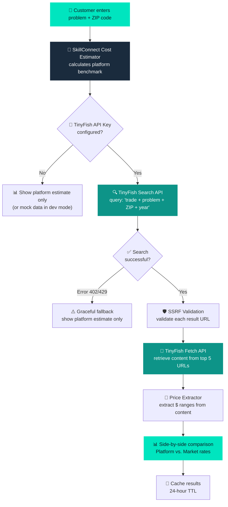

# TinyFish API — Integration Guide for SkillConnect

> **What is TinyFish?** TinyFish is a free-tier web intelligence API that provides **real-time web search and content fetching** capabilities. SkillConnect uses it to deliver **Live Local Price Intelligence** — giving homeowners independent market rate comparisons alongside our own transparent estimates.

---

## 🎯 What TinyFish Gives Us

TinyFish provides **two free API endpoints** that power SkillConnect's price comparison engine:

### 1. 🔍 Search API — Find Public Price Guides
| Detail | Value |
|--------|-------|
| **Endpoint** | `GET https://api.search.tinyfish.ai?query=...` |
| **Authentication** | `X-API-Key` header (server-side only) |
| **What it does** | Searches the web for public trade cost guides, pricing benchmarks, and repair cost articles |
| **Returns** | JSON array of results with `title`, `url`, `snippet`, and `date` |
| **Cost** | **Free** (rate-limited) |

**Example Query:**
```
GET https://api.search.tinyfish.ai?query=plumbing+sink+repair+cost+94107+2025
```

**Example Response:**
```json
[
  {
    "title": "Bob Vila: How Much Does Leaky Sink Repair Cost in 2025?",
    "url": "https://www.bobvila.com/articles/sink-repair-cost",
    "snippet": "Homeowners typically pay between $175 and $380...",
    "date": "2025-02-15"
  }
]
```

### 2. 📄 Fetch API — Extract Page Content
| Detail | Value |
|--------|-------|
| **Endpoint** | `POST https://api.fetch.tinyfish.ai` |
| **Authentication** | `X-API-Key` header (server-side only) |
| **Body** | `{ "url": "https://..." }` |
| **What it does** | Fetches and extracts readable content (markdown/text) from a given URL |
| **Returns** | Cleaned text content from the page |
| **Cost** | **Free** (rate-limited) |

**Example Request:**
```json
POST https://api.fetch.tinyfish.ai
{
  "url": "https://www.bobvila.com/articles/sink-repair-cost"
}
```

**Example Response:**
```json
{
  "content": "How Much Does It Cost to Fix a Leaky Sink? Homeowners typically pay between $175 and $380 for professional sink leak repairs...",
  "status": 200
}
```

---

## 🔄 How SkillConnect Uses TinyFish (Workflow)



---

## 🏗️ Architecture in SkillConnect

### File Structure
```
src/
├── app/api/price-intelligence/
│   ├── search/route.ts       # Proxy to TinyFish Search API
│   ├── fetch/route.ts        # Proxy to TinyFish Fetch API (with SSRF checks)
│   └── compare/route.ts      # Full pipeline: search → fetch → extract → compare
│
├── lib/price-intelligence/
│   ├── tinyfish-client.ts    # TinyFish API client (Search + Fetch)
│   ├── price-extractor.ts    # Extracts price ranges from fetched content
│   ├── security.ts           # SSRF validation + content sanitization
│   ├── cache.ts              # 24-hour in-memory cache
│   └── index.ts              # Pipeline orchestrator
│
└── components/pricing/       # UI components for price display
```

### API Route Map

| Route | Method | Pipeline |
|-------|--------|----------|
| `/api/price-intelligence/search` | `GET`/`POST` | Sanitize query → Check cache → TinyFish Search → Strip keys → Return |
| `/api/price-intelligence/fetch` | `POST` | Validate URL (SSRF) → TinyFish Fetch → Sanitize content → Return |
| `/api/price-intelligence/compare` | `POST` | Search + Concurrent Fetch + Price Extraction + Synthesis + Cache |

---

## 🛡️ Security Guardrails

| Protection | Implementation |
|-----------|---------------|
| **Server-side only** | API key never sent to browser; all calls via Next.js API routes |
| **SSRF Defense** | Blocks `127.0.0.0/8`, `10.0.0.0/8`, `172.16.0.0/12`, `192.168.0.0/16`, cloud metadata `169.254.169.254`, IPv6 loopback, credentials in URLs, non-standard ports |
| **Content Sanitization** | Strips scripts, styles, iframes, dangerous HTML attributes; truncates at 40KB |
| **Rate Limiting** | 25 requests/min per client IP (sliding window) |
| **Zero PII Exposure** | Only generic trade terms + 5-digit ZIP codes sent to TinyFish |
| **Graceful Degradation** | HTTP 402 (quota) / 429 (rate limit) → platform estimate shown without blocking user |

---

## ⚠️ Free Tier Limits & What We DON'T Use

### ✅ What We Use (Free)
- `GET https://api.search.tinyfish.ai` — Web search
- `POST https://api.fetch.tinyfish.ai` — Page content fetch

### ❌ What We NEVER Use (Paid)
- ~~TinyFish Agent~~ — AI agent automation
- ~~TinyFish Research~~ — Deep research
- ~~TinyFish Browser~~ — Browser automation
- ~~TinyFish Monitor~~ — Website monitoring
- ~~Any wallet-consuming endpoint~~

### Free Tier Behavior
| Scenario | HTTP Code | SkillConnect Behavior |
|----------|-----------|----------------------|
| Quota exhausted | `402` | Show platform estimate only, no error to user |
| Rate limited | `429` | Retry message, booking unaffected |
| Invalid key | `401`/`403` | Log warning, use mock data in dev |
| Timeout | `504` | 6-second abort, graceful fallback |
| Network error | `503` | Silent fallback to platform estimate |

---

## 🔧 Setup Instructions

### 1. Get Your Free API Key
1. Go to [https://tinyfish.ai](https://tinyfish.ai)
2. Sign up for a free account
3. Copy your API key (starts with `sk-tinyfish-...`)

### 2. Configure Locally
```bash
# Add to your .env.local
TINYFISH_API_KEY=sk-tinyfish-your_key_here
```

### 3. Configure for Vercel Deployment
1. Go to your Vercel Dashboard → **Settings** → **Environment Variables**
2. Add `TINYFISH_API_KEY` with your key
3. Enable for **Production**, **Preview**, and **Development**
4. Redeploy

### 4. Test Without API Key
Set mock mode in `.env.local`:
```bash
NEXT_PUBLIC_ENABLE_MOCK_INTELLIGENCE=true
```
This provides realistic simulated responses for development/testing.

---

## 📖 Further Reading
- [TinyFish Documentation](https://tinyfish.ai)
- [SkillConnect System Architecture](docs/architecture/SYSTEM-ARCHITECTURE.md)
- [Security Requirements](docs/security/SECURITY-REQUIREMENTS.md)
- [API Contract Specification](docs/architecture/API-CONTRACT-SPECIFICATION.md)
