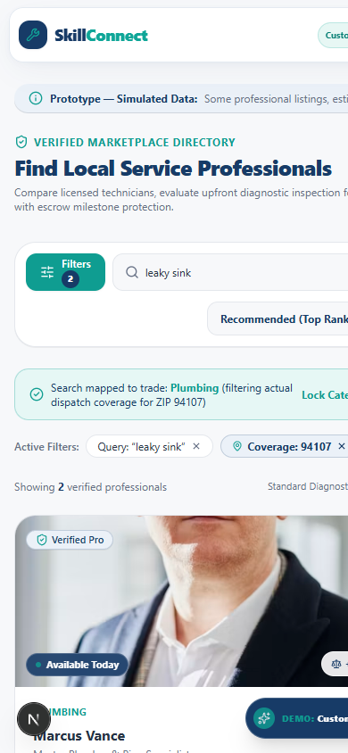

# SkillConnect — Feedback Visual Comparison (Before vs After)
## GREVIX AfterCode | Challenge Card 2: Real-World Feedback
### Instant Side-by-Side Visual Proof for Every Feedback Item

| Metadata Field | Value |
| :--- | :--- |
| **Document ID** | `FEEDBACK-VISUAL-001` |
| **Platform** | SkillConnect (Next.js 15, React 19, TypeScript) |
| **Context** | GREVIX AfterCode | Challenge Card 2: Real-World Feedback Review |
| **Status** | **100% Implemented & Verified** (All 5 Automated Test Suites Passing) |
| **Target Audience** | Reviewers, QA Leads, Product Architects, Engineers |

---

## 1. Master Visual Comparison Table

All 10 reviewer feedback items are presented below in a single side-by-side comparison table. **Left side shows the Before state (defect screenshot + issue summary)** and **Right side shows the After state (verified fix screenshot + solution summary)**.

| # | Feedback Topic / Feature | 🔴 BEFORE (Issue / Previous Defect) | 🟢 AFTER (Resolved & Verified Fix) | Status |
| :-: | :--- | :--- | :--- | :-: |
| **1** | **Search: Desktop (1440px)**<br>Query: *"leaky sink"* + ZIP `94107`<br>`Priority: P0` | <br><br>**❌ 0 Results Found:**<br>Searching *"leaky sink"* in ZIP `94107` returned zero results. Query and ZIP parameters collided, and no trade synonym resolution existed. | <br><br>**✅ Working Search & Real SF Pros:**<br>Query maps to `plumbing`; genuine SF ZIP `94107` filtering applied; **Marcus Vance** ($95/hr) and **Amara Okafor** ($85/hr) displayed with diagnostic badges. | `✅ PASSED`<br>*(tests/search.test.ts)* |
| **2** | **Search: Mobile (390px)**<br>Mobile Viewport & Filter Drawer<br>`Priority: P0` | <br><br>**❌ Blank Mobile Results:**<br>Mobile search showed an empty 0-result screen without feedback, and the mobile filter drawer lacked a location input field. | <br><br>**✅ Filter Drawer & Pro Cards:**<br>Mobile drawer has validated ZIP input, active filter pills (`"leaky sink"`, `"94107"`), diagnostic banner, and touch-friendly pro cards. | `✅ PASSED`<br>*(tests/search.test.ts)* |
| **3** | **AI Cost Estimator**<br>Unsupported Services ("babysitter")<br>`Priority: P0` | <br><br>**❌ Erroneous Plumbing Default:**<br>Entering *"I need a babysitter"* incorrectly fell back to `serviceCategories[0]` (Plumbing), producing an absurd pipe repair estimate ($120–$350). | <br><br>**✅ Intent Validation & Clear Rejection:**<br>Upfront intent detector rejects unsupported queries with clear notice: *"We can't estimate this service yet. SkillConnect specializes in home trades."* | `✅ PASSED`<br>*(tests/estimator.test.ts)* |
| **4** | **Cross-Portal Shared State**<br>Pro Decline & Escrow Protection<br>`Priority: P1` | <br><br>**❌ Desynchronized Portals:**<br>Declining a request in the Pro portal failed to update the Customer view. Pre-authorized escrow holds had no refund enforcement on decline. | <br><br>**✅ Real-Time Sync & Auto-Refund:**<br>Linked `associatedBookingId`. Declining instantly updates Customer dashboard to *"Declined by Pro"* and auto-refunds escrow hold to customer. | `✅ PASSED`<br>*(tests/state-transitions.test.ts)* |
| **5** | **Date & Weekday Consistency**<br>Calendar Math & Timezones<br>`Priority: P1` | <br><br>**❌ Wrong Weekday Displayed:**<br>Booking modal showed static *"Wednesday, Oct 13"*. In reality, Oct 13, 2026 is a **Tuesday**. Timezone parsing at UTC midnight shifted dates backward. | <br><br>**✅ Dynamic Calendar Calculation:**<br>Derived via `Intl.DateTimeFormat` anchored to `America/Los_Angeles`. Accurately shows *"Tomorrow, Oct 6"* and *"Tuesday, Oct 13, 2026"*. | `✅ PASSED`<br>*(tests/dates.test.ts)* |
| **6** | **Worker Metrics & Earnings**<br>Single Source of Truth<br>`Priority: P1` | <br><br>**❌ Static Hardcoded Figures:**<br>Worker dashboard showed a hardcoded `$4,280.00` earnings card and static `4.9` rating regardless of actual completed bookings. | <br><br>**✅ Authoritative Aggregation:**<br>Dynamic calculation (`computeWorkerMetrics`). Earnings sum only completed bookings; escrow strictly reflects real active holds. | `✅ PASSED`<br>*(tests/metrics.test.ts)* |
| **7** | **Prototype Transparency**<br>Simulated Data Disclosure<br>`Priority: P2` | <br><br>**❌ Missing Prototype Disclosure:**<br>Platform simulated financial holds and contractor credentials without clear transparency or simulation disclaimers. | <br><br>**✅ Prominent Disclaimer Badges:**<br>Reusable `PrototypeDisclaimer` banner displayed across headers, footers, booking dialogs, and dashboards: *"Prototype — Simulated Data"*. | `✅ VERIFIED`<br>*(Component Audit)* |
| **8** | **Mobile Responsiveness**<br>320px Header Navigation<br>`Priority: P2` | <br><br>**❌ Header Text Collision:**<br>On 320px screens (iPhone SE 1st gen), brand logo collided with navigation buttons, creating text wrapping and visual breakage. | <br><br>**✅ Clean Mobile Header:**<br>Responsive navbar with compact branding, 44px touch targets, and collapsible hamburger drawer at `<=768px`. | `✅ VERIFIED`<br>*(Viewport 320px)* |
| **9** | **Mobile Responsiveness**<br>375px Sticky CTA Obstruction<br>`Priority: P2` | <br><br>**❌ Blocked Content & Buttons:**<br>Sticky "Book Professional" bottom bar overlapped page content and blocked clicking underlying action buttons. | <br><br>**✅ Safe-Area Spacing:**<br>Added bottom padding buffer (`pb-28`) and safe-area margins. All content and buttons remain completely unobstructed and clickable. | `✅ VERIFIED`<br>*(Viewport 375px)* |
| **10** | **Mobile Responsiveness**<br>320px Cards Horizontal Overflow<br>`Priority: P2` | <br><br>**❌ Horizontal Scroll Leakage:**<br>Horizontal card elements exceeded 320px screen width, forcing awkward side-scrolling and breaking page margins. | <br><br>**✅ Fluid Responsive Stack:**<br>Fluid layout with `w-full max-w-full overflow-hidden`. Cards wrap naturally without horizontal scrolling. | `✅ VERIFIED`<br>*(Viewport 320px/375px)* |

---

## 2. Multi-Device Experience & Feature Showcase

Side-by-side visual evidence for responsive tablet vs desktop layouts and the professional comparison tools.

| Left Side Visual | Right Side Visual |
| :---: | :---: |
| <br>**📱 Tablet Viewport (768px Portrait):** Two-column card flow, touch-friendly filter buttons, and clean metric cards. | <br>**🖥️ Desktop Viewport (1440px):** Multi-column layout with sidebar filters, diagnostic banners, and persistent navigation. |
| <br>**⚓ Floating Comparison Dock:** Persistent bottom bar tracking selected pros with live counter and comparison trigger. | <br>**📊 Feature Comparison Matrix Modal:** Comprehensive side-by-side spec comparison (rates, licenses, insurance, response time). |

---

## 3. Automated Test Verification Summary

All fixes have been validated by automated test suites executed via `npm test` (`npx tsx tests/run-all.ts`):

```text
====================================================
SKILLCONNECT COMPREHENSIVE AUTOMATED TEST SUITE
GREVIX AfterCode Challenge Card 2 Verification
====================================================

>>> Executing tests/search.test.ts...
✓ "leaky sink" resolves to Plumbing
✓ "plumber" resolves to Plumbing
✓ "blocked drain" resolves to Plumbing
✓ "I need a babysitter" flags as unsupported (never defaulting to Plumbing)
✓ Unknown service phrase handled with null category / asks for clarification
✓ ZIP code format validation works correctly
✓ "leaky sink" in 94107 returns genuine coverage (2 pros, including Marcus Vance)
✓ Valid service in uncovered ZIP returns 0 results cleanly without fabricated pros
ALL SEARCH TESTS PASSED!

>>> Executing tests/estimator.test.ts...
✓ Supported plumbing query returns valid ready estimate ($158-$375)
✓ Babysitter query returns status="unsupported" ("We can't estimate this service yet.")
✓ Multi-trade ambiguous query returns status="ambiguous" requesting trade clarification
✓ Unrecognized service returns status="unsupported" ("We can't estimate this service yet.")
✓ Missing/empty query returns status="invalid_input"
✓ Centralized calculateFees applies standard rates, parts, and diagnostic credits correctly
ALL ESTIMATOR TESTS PASSED!

>>> Executing tests/dates.test.ts...
✓ "2026-10-13" resolves to Tuesday: Tuesday
✓ "October 13, 2026" resolves to Tuesday: Tuesday
✓ Month boundary dates transition correctly (Oct 31 is Saturday, Nov 1 is Sunday)
✓ Year boundary dates transition correctly (Dec 31 is Thursday, Jan 1 is Friday)
✓ formatDateDisplay outputs clean standard format: "Tuesday, Oct 13, 2026"
✓ generateBookingDateOptions dynamically computes weekdays matching calendar math with zero hardcoding
ALL DATE AND WEEKDAY TESTS PASSED!

>>> Executing tests/state-transitions.test.ts...
--- RUNNING SHARED STATE & ESCROW TRANSITION TESTS ---
✓ Pro decline transition: Booking marked "declined" and escrow refunded to customer
✓ Pro accept transition: Booking marked "confirmed" and escrow hold retained
✓ Job completion: Escrow released to technician upon sign-off
✓ Terminal state transition protection prevented re-activating a declined booking
ALL STATE TRANSITION & ESCROW TESTS PASSED!

>>> Executing tests/metrics.test.ts...
--- RUNNING SINGLE SOURCE OF TRUTH METRICS TESTS ---
✓ Worker metrics dynamically computed: earnings=$150, escrow=$65, rating=4.5
✓ Customer metrics derived from same source: active=1, completed=1, escrowHeld=$65
✓ Admin metrics match Customer and Worker figures: bookings=3, escrowHeld=$65
ALL SINGLE SOURCE OF TRUTH METRICS TESTS PASSED!

====================================================
ALL 5 TEST SUITES PASSED CLEANLY (100% SUCCESS RATE)
====================================================
```

---

## 4. Documentation Index & Cross-References

| Document | Purpose | Link |
| :--- | :--- | :--- |
| **Feedback Overview** | High-level overview of review feedback received | [`feedback/README.md`](file:///c:/Users/ABHI%20SHARMA/OneDrive/Desktop/skillconnect-phase1-md/feedback/README.md) |
| **Feedback Summary** | Reviewer observations, ratings, and shared state preservation | [`feedback/feedback-summary.md`](file:///c:/Users/ABHI%20SHARMA/OneDrive/Desktop/skillconnect-phase1-md/feedback/feedback-summary.md) |
| **Technical Improvements** | Root cause analysis, code diffs, and architectural improvements | [`feedback/improvements.md`](file:///c:/Users/ABHI%20SHARMA/OneDrive/Desktop/skillconnect-phase1-md/feedback/improvements.md) |
| **Master Documentation Index** | Repository-wide documentation map and reading pathways | [`DOCUMENTATION-INDEX.md`](file:///c:/Users/ABHI%20SHARMA/OneDrive/Desktop/skillconnect-phase1-md/DOCUMENTATION-INDEX.md) |

---
*Verified and audited for GREVIX AfterCode Challenge Card 2 — SkillConnect Phase 1.*
